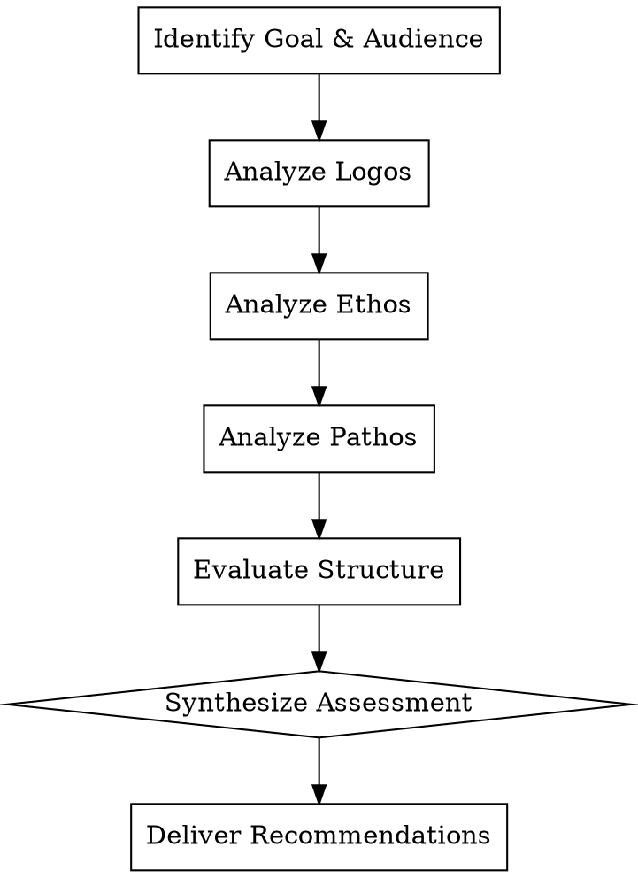

# Persuasive Analysis

## Overview

**Persuasive analysis evaluates how effectively a text achieves its influence goals using the classical rhetorical framework: logos (logic), ethos (credibility), and pathos (emotion).**

This skill applies Aristotle's modes of persuasion to modern communication, providing a structured method to diagnose why arguments succeed or fail with their intended audience.

## When to Use

- Evaluating marketing copy, sales pages, or advertisements
- Reviewing speeches, op-eds, or persuasive essays
- Analyzing why a pitch deck did/didn't land
- Debugging unsuccessful proposals or recommendations
- Studying effective rhetoric in successful campaigns

**Do NOT use for:**
- Purely informational text evaluation — use text-assessment
- Creative writing critique — use literary analysis
- Fact-checking research — use text-assessment
- Simple proofreading — use proof-read

## The Three Modes of Persuasion

| Mode | Greek | Focus | Key Questions |
|------|-------|-------|---------------|
| **Logos** | Logic | Argument quality, evidence, reasoning | Is the argument sound? Is evidence credible and relevant? |
| **Ethos** | Character | Author credibility, trustworthiness | Why should the audience believe this source? |
| **Pathos** | Emotion | Emotional engagement, values alignment | Does it connect with audience feelings and values? |

## Analysis Framework

### Step 1: Identify Persuasive Goal

Define what success looks like:

- **Primary objective**: What action or belief change is sought?
- **Target audience**: Who must be convinced?
- **Context**: Where/how will this be consumed?

### Step 2: Analyze by Mode

#### Logos Analysis

| Element | What to Evaluate |
|---------|------------------|
| **Main claim** | Clear? Specific? Debatable but defensible? |
| **Supporting evidence** | Sufficient quantity? Appropriate quality? |
| **Reasoning** | Valid deductions? No logical fallacies? |
| **Counter-arguments** | Acknowledged and addressed? |
| **Completeness** | Key aspects covered for the scope? |

**Common logical fallacies to flag:**
- Ad hominem (attacking person, not argument)
- False dichotomy (only two options presented)
- Appeal to authority (expert cited outside their domain)
- Post hoc ergo propter hoc (correlation = causation)
- Slippery slope (minor action → major disaster)

#### Ethos Analysis

| Element | What to Evaluate |
|---------|------------------|
| **Credentials** | Expertise demonstrated or cited? |
| **Transparency** | Potential biases disclosed? |
| **Fairness** | Opposing views represented accurately? |
| **Consistency** | Internal contradictions? Past alignment? |
| **Tone** | Respectful? Arrogant? Pandering? |

#### Pathos Analysis

| Element | What to Evaluate |
|---------|------------------|
| **Emotional hooks** | Fear, hope, anger, joy — appropriate to goal? |
| **Values alignment** | Connects to audience core beliefs? |
| **Vivid language** | Concrete imagery? Sensory details? |
| **Empathy** | Demonstrates understanding of audience concerns? |
| **Ethics** | Manipulative or exploitative? |

### Step 3: Evaluate Structure & Delivery

| Component | Assessment Criteria |
|-----------|---------------------|
| **Opening** | Hooks attention? Establishes relevance? States purpose? |
| **Flow** | Logical progression? Smooth transitions? |
| **Pacing** | Key points given appropriate weight? No rushed conclusions? |
| **Closing** | Reinforces main message? Clear call to action? Memorable? |

### Step 4: Rhetorical Devices

Identify and evaluate effectiveness of:

| Device | Example | Effectiveness Check |
|--------|---------|---------------------|
| **Metaphor/Analogy** | "This policy is a Band-Aid solution" | Illuminates or obscures? |
| **Repetition** | "We want change. We need change. We demand change." | Adds emphasis or becomes monotonous? |
| **Rhetorical question** | "What kind of world do we want to leave our children?" | Engages or feels manipulative? |
| **Triples** | "Life, liberty, and the pursuit of happiness" | Completes naturally or forced? |
| **Contrast** | "Ask not what your country can do for you..." | Sharpens distinction or oversimplifies? |

## Delivering the Assessment

### Overall Persuasiveness Rating

Use this scale with brief justification:

| Rating | Description |
|--------|-------------|
| **Highly Persuasive** | Strong across all three modes; likely to achieve goal |
| **Persuasive** | Solid foundation with minor weaknesses |
| **Moderately Persuasive** | Mixed effectiveness; some audience segments convinced |
| **Weakly Persuasive** | Significant gaps in one or more modes |
| **Not Persuasive** | Fundamental flaws; unlikely to achieve goal |

### Report Structure

1. **Goal & Audience Summary** (2-3 sentences)
2. **Mode-by-Mode Analysis** — Strengths and weaknesses per mode
3. **Structural Assessment** — Opening, flow, closing effectiveness
4. **Top 2-3 Strengths** — What's working well
5. **Top 2-3 Weaknesses** — Priority improvement areas
6. **Prioritized Recommendations** — Specific, actionable improvements ranked by impact

## Common Mistakes in Persuasive Writing

| Mistake | Example | Fix |
|---------|---------|-----|
| **Ignored audience values** | Arguing cost to parents who care about safety | Lead with safety, support with cost |
| **Weak evidence** | "Many people say..." | Use specific statistics or expert citations |
| **Missing call to action** | Strong argument, no next step | End with explicit, achievable request |
| **Over-reliance on one mode** | All emotion, no facts; all facts, no connection | Balance logos, ethos, pathos |
| **Too many arguments** | 15 reasons when 3 strong ones suffice | Prioritize strongest points |
| **Dismissive of opposition** | "Only fools would disagree..." | Acknowledge valid concerns, then rebut |

## Red Flags — STOP and Flag

- **Audience mismatch**: Message designed for wrong demographic
- **No clear ask**: Reader persuaded but doesn't know what to do
- **Ethical violations**: Manipulation of vulnerable populations
- **Factually false claims**: Misinformation presented as evidence
- **Pure pathos without substance**: Emotional manipulation without logical backing

## Example Analysis Summary

**Text**: Product launch email for productivity app

**Goal**: Convince busy professionals to start free trial

**Assessment**:
| Mode | Rating | Notes |
|------|--------|-------|
| Logos | Good | Specific time-saving stats; one unsupported claim about "industry-leading" |
| Ethos | Fair | No author credentials; testimonials help but lack specificity |
| Pathos | Strong | Opens with relatable frustration; ends with aspirational vision |

**Top Strengths**:
1. Strong emotional hook: "Tired of endless email chains?" — immediate audience recognition
2. Clear value proposition: "Save 5 hours per week" — specific, measurable benefit

**Top Weaknesses**:
1. Weak CTA: "Learn more" instead of "Start free trial"
2. Missing objection handling: No mention of data security for privacy-conscious audience

**Priority Recommendations**:
1. **[High]**: Change CTA to "Start your free 14-day trial" — reduces friction, adds urgency
2. **[High]**: Add one-sentence security note: "Your data is encrypted and never shared"
3. **[Medium]**: Replace generic testimonial with specific quote: "Saved me 6 hours last month" — Sarah K., Marketing Director
