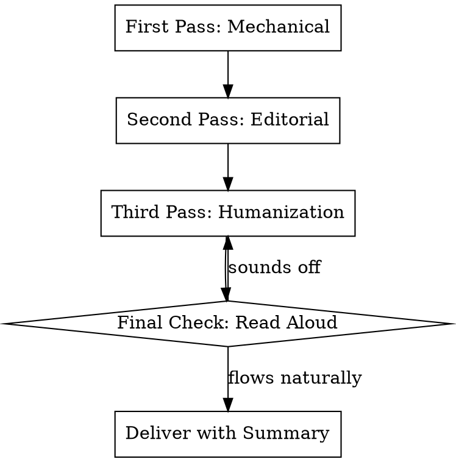

# Proof-Read

## Overview

**Proof-reading is the final refinement stage that transforms rough drafts into polished, human-sounding text.**

This skill combines mechanical accuracy (grammar, spelling, punctuation) with editorial judgment (clarity, flow, tone). The goal is not just correctness—it's creating text that reads naturally and engages the reader without friction.

## When to Use

- Final pass before publishing or sending any written content
- Editing AI-generated text that feels robotic or generic
- Trimming wordy drafts to essential message
- Unifying tone and style across multi-author documents
- Fixing "almost right" text that isn't quite landing

**Do NOT use for:**
- Initial drafting — use outlining or brainstorming skills first
- Major structural rewrites — reorganize content before proof-reading
- Fact-checking research claims — use text-assessment for verification
- Style guide compliance (APA, Chicago, etc.) — refer to specific guides

## The Proof-Read Process



## Three-Pass System

### Pass 1: Mechanical (Accuracy)

Check for objective errors:

| Check | What to Look For |
|-------|------------------|
| **Spelling** | Typos, homophones (their/there/they're), proper nouns |
| **Grammar** | Subject-verb agreement, tense consistency, article usage |
| **Punctuation** | Comma splices, missing commas, incorrect apostrophes |
| **Facts** | Dates, names, numbers, statistics (flag if unverifiable) |
| **Consistency** | Capitalization, hyphenation, formatting, tense |

### Pass 2: Editorial (Clarity & Impact)

Refine for reader experience:

| Issue | Fix Strategy |
|-------|--------------|
| **Wordiness** | Cut "in order to" → "to"; "due to the fact that" → "because" |
| **Repetition** | Merge similar sentences; use pronouns or synonyms |
| **Complex sentences** | Split >25 word sentences; one idea per sentence |
| **Weak openings** | Start with subject + verb; avoid "There is/are" |
| **Jargon** | Replace insider terms with plain language or define them |
| **Passive voice** | Convert to active where it clarifies who acts |

### Pass 3: Humanization (Tone & Flow)

Remove robotic patterns common in AI output:

| AI Pattern | Human Alternative |
|------------|-------------------|
| "It is important to note that..." | Delete or replace with direct statement |
| "In today's world..." / "In the modern era..." | Delete — get to the point |
| "This comprehensive analysis will..." | State what it does directly |
| Lists of three where two suffice | Cut the weakest item |
| "Leverage," "utilize," "facilitate" | Use "use," "help," "make" |
| Overly formal transitions | Use conversational connectors |
| Perfect parallel structure | Vary sentence rhythm slightly |
| "Not only X but also Y" constructions | Simplify to "X and Y" |

## AI-Generated Text Markers

Flag these common AI tells:

- **Hedging language**: "It is worth noting," "One might consider," "It seems that"
- **Generic intensifiers**: "significant," "crucial," "vital," "essential" without specificity
- **Bullet point overuse**: Three-item lists where prose flows better
- **Abstract openings**: Starting with definitions or broad context before the point
- **Conclusion restatements**: Summarizing what was just said in the final paragraph
- **Even rhythm**: Sentences of similar length creating a metronome effect

## Deliverables

After editing, provide:

1. **Edited text** — The polished version ready for use

2. **Summary of changes** including:
   - Word count reduction (before → after)
   - Major restructuring changes
   - Specific AI-like phrases humanized
   - Consistency fixes applied

### Summary Template

```
Changes Made:
• Word count: [X] → [Y] ([Z]% reduction)
• Mechanical: [N] spelling/grammar/punctuation fixes
• Editorial: [Specific changes, e.g., "Split 4 long sentences"]
• Humanization: [Specific AI patterns removed, e.g., "Removed 'It is important to note' hedging"]
• Flow improvements: [e.g., "Varied sentence rhythm, strengthened paragraph openings"]
```

## Common Mistakes

| Mistake | Why It Fails | Fix |
|---------|--------------|-----|
| Editing in one pass | Misses issues that need distance | Take breaks between passes |
| Preserving author's voice when it sucks | Polished mediocrity is still mediocre | Fix structural issues first |
| Over-editing | Removes personality and warmth | Stop when it sounds natural |
| Only reading silently | Misses awkward rhythm and missing words | Read final version aloud |
| Changing meaning while tightening | Accuracy trumps brevity | Verify facts after cuts |
| Ignoring context | What's clear to you may not be to reader | Consider audience knowledge |

## Red Flags — STOP and Reassess

- **Word count increased**: Proof-reading should reduce or maintain length
- **Lost the main point**: If the core message got buried, undo and restart
- **Sounds like a different person**: Too much editing strips authentic voice
- **Can't read aloud smoothly**: If you stumble reading it, readers will too
- **Multiple passes, still not right**: The text may need rewriting, not editing

## Example Transformation

**Original (AI-like)**:
> It is important to note that in today's fast-paced business environment, organizations must leverage comprehensive data analytics solutions in order to remain competitive. Not only do these tools facilitate better decision-making processes, but they also enable teams to identify significant trends and patterns. It is worth mentioning that companies that fail to adopt these technologies may face substantial challenges.

**Edited (Human)**:
> Organizations need data analytics to stay competitive. These tools help teams spot trends and make better decisions. Companies that ignore them fall behind.

**Changes**:
- Word count: 57 → 28 (51% reduction)
- Removed hedging: "It is important to note," "It is worth mentioning"
- Removed filler: "in today's fast-paced business environment," "comprehensive," "in order to"
- Simplified: "leverage" → "need", "facilitate" → "help", "significant trends and patterns" → "trends"
- Strengthened ending: "may face substantial challenges" → "fall behind"
