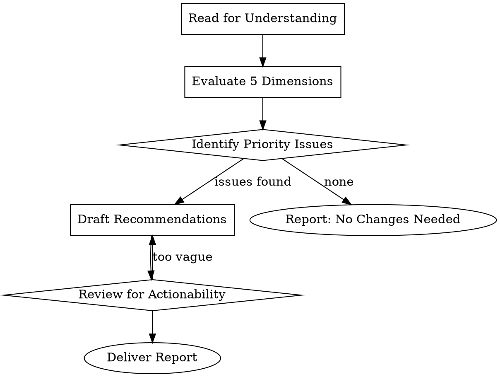

# Text Assessment

## Overview

**Text assessment is a systematic evaluation of written content across five dimensions: clarity, logic, factual accuracy, communication effectiveness, and completeness.**

This skill provides a structured framework for analyzing any text — from emails to reports to creative writing — and producing actionable improvement recommendations.

## When to Use

- Reviewing drafts before publication or distribution
- Editing content written by others (or yourself)
- Assessing whether a text achieves its intended purpose
- Identifying gaps or weaknesses in written communication
- Providing constructive feedback on writing quality

**Do NOT use for:**
- Simple proofreading (grammar/spelling only) — use a linter
- Highly specialized domain review (legal, medical) — consult subject experts
- Style guide enforcement — refer to specific style guides

## Assessment Framework

Evaluate the text across these five dimensions:

| Dimension | What to Check | Red Flags |
|-----------|---------------|-----------|
| **Clarity** | Sentence structure, word choice, jargon use | Long sentences, undefined terms, ambiguous phrasing |
| **Logic** | Argument flow, cause-effect relationships, structure | Non-sequiturs, circular reasoning, missing transitions |
| **Factual Accuracy** | Claims, statistics, references, data | Unsourced statistics, outdated information, contradictions |
| **Communication** | Core message delivery, audience alignment, engagement | Unclear purpose, mismatched tone, boring opening |
| **Completeness** | Coverage of topic, missing perspectives, scope appropriateness | Obvious gaps, ignored counterarguments, premature conclusions |

## Assessment Process

## Delivering the Assessment Report

Structure your assessment as follows:

### 1. Executive Summary
- Overall verdict (strong/needs work/major revision)
- The single most important improvement opportunity

### 2. Dimension Scores
Rate each dimension (Excellent/Good/Fair/Poor) with a 1-2 sentence justification:
- **Clarity**: [Score] — [Brief justification]
- **Logic**: [Score] — [Brief justification]
- **Factual Accuracy**: [Score] — [Brief justification]
- **Communication**: [Score] — [Brief justification]
- **Completeness**: [Score] — [Brief justification]

### 3. Priority Improvements
List 3-5 specific, actionable steps prioritized by impact:
1. **[High/Medium/Low]**: [Specific action] — [Why it matters]
2. ...

### 4. Quick Wins
List 2-3 changes that can be made immediately with minimal effort.

## Common Mistakes

| Mistake | Why It Fails | Fix |
|---------|--------------|-----|
| Vague feedback | "Make it better" provides no guidance | Use specific examples: "Replace passive voice in paragraph 2" |
| Nitpicking early | Focus on commas when structure is broken | Address macro issues before micro issues |
| Ignoring audience | Assessment without reader context | Always consider: who reads this and why? |
| No prioritization | Overwhelming list of 20 fixes | Rank by impact; limit to top 5 |
| Missing the "so what" | Notes problems without explaining impact | Every issue needs a "because..." |

## Red Flags — STOP and Reassess

- **You can't identify the core message**: Ask the author (or yourself) "What should the reader remember?"
- **Major factual claims without sources**: Flag as "cannot verify — requires citation"
- **Text contradicts itself**: Logic issues take priority over style issues
- **Wrong format for audience**: A memo written as an essay needs restructuring, not just editing

## Example Assessment

**Text**: A 3-paragraph project update email

**Assessment**:

| Dimension | Score | Notes |
|-----------|-------|-------|
| Clarity | Good | Clear language, but "the initiative" is ambiguous in paragraph 2 |
| Logic | Fair | Timeline in paragraph 3 contradicts earlier stakeholder meeting |
| Factual Accuracy | N/A | No statistics or claims requiring verification |
| Communication | Good | Opens with main point; appropriate tone |
| Completeness | Poor | Omits budget status and risk assessment entirely |

**Priority Improvements**:
1. **[High]**: Clarify timeline conflict — paragraph 3 says "on track for March" but stakeholders were told April
2. **[High]**: Add budget status section — readers need cost context for decisions
3. **[Medium]**: Replace "the initiative" with specific project name for clarity
4. **[Medium]**: Add brief risk paragraph (even if no risks) to show due diligence

**Quick Wins**:
- Add subject line prefix: "[Project X Update]" for searchability
- Bullet the three milestones instead of sentence list
